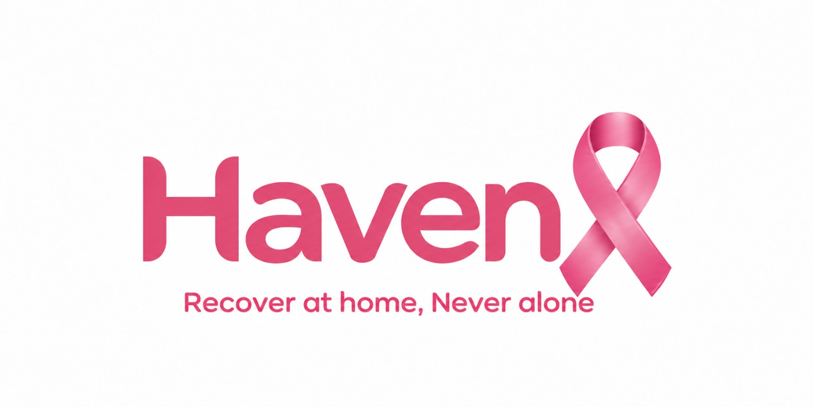
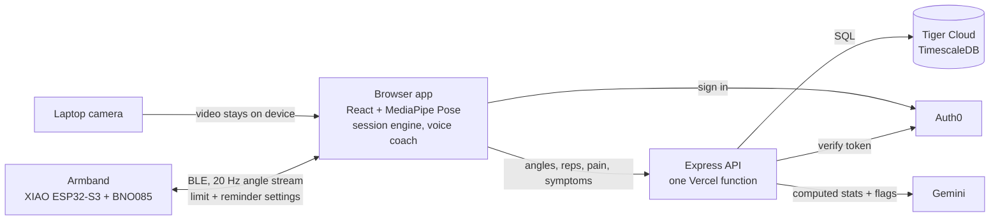

<p align="center">
  
</p>

# Haven

**Recover at home. Never alone.**

[](https://devpost.com/software/haven-xuzh06)
[](https://devpost.com/software/haven-xuzh06)

Haven is a home rehab coach for shoulder recovery after breast cancer surgery. A laptop camera and a wearable armband guide each exercise, keep the patient inside the limits their physical therapist set, and give the PT a clear picture of recovery between visits.

| | |
|---|---|
| Live site | [havenn.health](https://havenn.health) |
| For judges | [havenn.health/judges](https://havenn.health/judges): a scripted session and the PT console, no camera needed |
| Devpost | [devpost.com/software/haven-xuzh06](https://devpost.com/software/haven-xuzh06) |
| Demo video | [YouTube](https://www.youtube.com/watch?v=geaNhb0acck) |

> Haven is a hackathon prototype, not a medical device. It does not diagnose or treat anything, and the range limits in the demo are placeholders: real limits come from the patient's surgeon or physical therapist.

## The problem

After breast cancer surgery, most shoulder rehab happens alone at home, and between visits the physical therapist can't see how high the arm got, whether it hurt, or whether a limit was crossed. Guidance matters: in a 2024 randomized trial, 85.7% of patients on an early, tailored exercise program regained full shoulder strength within six months, compared with 18% on usual care ([Min et al., JAMA Surgery](https://doi.org/10.1001/jamasurg.2024.1633)).

## What it does

- **Movement reminders.** The PT sets a reminder interval, and the armband chirps when the arm hasn't been raised above 60° for that long.
- **Guided reps with voice coaching.** Pose tracking on the laptop camera counts every rep, measures its peak angle, and catches shrugging, leaning and a bent elbow. A warm recorded voice talks the patient through each set, asks for a pain rating after it, and checks for swelling or cording at the end.
- **Care team limits enforced on the band.** The PT's range limit is sent to the armband whenever it connects. The band beeps faster as the arm nears the limit and alarms above it, during sessions and between them.
- **Clinician dashboard.** PTs add patients, set the recovery phase, exercises, sets, reps, limits and goals, and follow range of motion, pain, form, daily arm use, the latest armband trace and every flag.
- **Verified AI reports.** Gemini writes a plain summary for the patient and a one-page report for the PT, and the server checks every number in that text against the data.

Six exercises are built in: side raise, scaption raise, forward raise, wall walk, shoulder rolls and elbow winging.

## Architecture



The browser does all the vision work. The API only ever sees numbers: angles, rep counts, pain ratings and symptom answers.

## Tech stack

| Layer | Tools |
|---|---|
| Wearable | Seeed XIAO ESP32-S3, BNO085 IMU, buzzer, LiPo battery, Bluetooth Low Energy (Nordic UART service) |
| Frontend | React 19, TypeScript, Vite, MediaPipe Tasks Vision (Pose Landmarker), Web Bluetooth, Web Audio, Web Speech, GSAP, Vitest |
| Backend | Node.js 22, Express 5, node-postgres, Google Gen AI SDK (Gemini), Vitest |
| Database | Tiger Cloud (TimescaleDB on Postgres): hypertables, columnstore, continuous aggregates |
| Auth | Auth0 (`@auth0/auth0-react` in the browser, `express-oauth2-jwt-bearer` on the API) |
| Hosting | Vercel (static app plus one Node function), custom domain havenn.health |

The coaching voice is a pack of clips recorded ahead of time with Gemini text to speech (`npm run voice-pack`), so sessions play natural speech instantly and offline.

## Data design

Haven's data is time series at heart: every rep, every armband sample and every minute of daily arm use has a timestamp. The schema is plain Postgres ([`001_schema.sql`](db/migrations/001_schema.sql)), and [`002_timescale.sql`](db/migrations/002_timescale.sql) layers Tiger Data on top.

### Hypertables

| Table | What it holds | Chunk interval | Storage |
|---|---|---|---|
| `band_samples` | The armband's raw 20 Hz stream during sessions (elevation, angular rate) | 1 day | Columnstore after 1 day, segmented by `patient_id`, ordered by `t desc` |
| `daily_use` | Per-minute summaries from the band's daily use mode (peak elevation, raises above 90°, active minutes) | 7 days | Columnstore after 7 days, segmented by `patient_id`, ordered by `bucket_start desc, bucket_minutes` |
| `reps` | Every rep: peak angle, duration, source (camera or band), limit and form flags, the band's peak for the same rep | 7 days | Row store |

The raw band stream is the bulk of the data, 20 rows a second per patient, so it moves to the columnstore after a day. Segmenting by patient keeps each patient's history contiguous, which is exactly how the dashboard reads it.

### Continuous aggregates

Two daily rollups, both bucketed by the patient's local day with `time_bucket(..., 'America/New_York')`:

- **`rom_daily`** from `reps`: best and mean peak angle, rep count, reps over the limit, reps with compensation, and the average camera vs band gap, per patient, exercise, arm and day.
- **`daily_use_daily`** from `daily_use`: active minutes, raises above 90° and peak elevation per patient and day.

Both run in real-time mode (`materialized_only = false`), so a session shows up on the dashboard the moment it is saved, and a policy refreshes the last 90 days every 15 minutes.

### Choices that make it work

- `reps` copies `patient_id`, `exercise_id`, `side` and `kind` from its parent rows so the continuous aggregate can roll up without joins.
- Each set stores a snapshot of the limit in force, so changing a prescription never rewrites history.
- Sessions are written in one transaction, with reps and band samples batch inserted through `unnest` (one round trip per set, one for the whole band trace).
- `001_schema.sql` defines `rom_daily` and `daily_use_daily` as plain views with the same columns, so the app also runs on ordinary Postgres; `db:setup` skips the Timescale migration where the extension isn't available.

### What the dashboard reads

| Source | Used for |
|---|---|
| `rom_daily` | Range of motion chart, form chart, camera vs band agreement, range and limit flags |
| `daily_use_daily` | Daily arm use panel, low use and at-home limit flags |
| `session_summary` (view over `sessions`, `sets`, `symptom_logs`) | Pain chart, session log, pain and symptom flags |
| `band_samples` | The last session's armband trace, max pooled to 2 Hz in SQL so peaks survive |
| `timescaledb_information` views and `hypertable_columnstore_stats` | The Database panel: chunks, columnstore chunks and compression ratio per table |
| `patients`, `prescriptions`, `baselines` | The care plan and the reference each range is compared against |
| `reports` | The latest Gemini report, with the exact stats it was given |

The band as built doesn't keep its daily use log yet (see [Hardware](#hardware)), so the `daily_use` rows in the demo come from the seed data.

## Safety and trust

- **Deterministic rules raise every flag.** [`flags.ts`](web/src/lib/flags.ts) flags range loss, rising or high pain, reported swelling or cording, low daily arm use, limit breaks in sessions and at home, more compensation and missed sessions. The same code runs in the server and the app, straight from the rollups.
- **Gemini only writes wording.** It receives the computed stats and flags as JSON, never video. Its instructions forbid new numbers, diagnoses, and adding, dropping or regrading a flag. Requests are sent with `store: false`.
- **Every number is checked.** [`numberGuard.ts`](web/src/lib/numberGuard.ts) pulls every number out of Gemini's text and looks for it in the data it was given. If any are missing, the server sends the draft back once with those numbers named; anything still unsupported is saved with the report and shown to the PT.
- **Limits come from the plan, not the request.** When a session is saved, the server takes the phase, each set's limit and every over-limit mark from the PT's plan, so an edited request can't hide a limit break.
- **Video never leaves the computer.** MediaPipe Pose runs in the browser, with the model and runtime served from the app itself. Patients can hide the camera image and see only an outline of their arm. Voice answers to the pain question are optional, since browser speech recognition may use a cloud service.
- **Roles come from verified emails.** Clinicians are the addresses in `CLINICIAN_EMAILS`. A patient signs in to the record their PT created for their email, and anyone else sees the demo patient read only. Only an email Auth0 has verified counts.

## Hardware

- **Board:** Seeed XIAO ESP32-S3
- **Sensor:** BNO085 IMU sampled at 100 Hz, measuring the upper arm's angle against gravity
- **Link:** Bluetooth Low Energy to the browser at 20 Hz
- **Alerts:** a buzzer that beeps faster from 10° below the PT's limit, alarms above it, and chirps as a movement reminder
- **Power:** 600 mAh LiPo

In a session the camera leads and the band fills in when the camera loses sight of the arm. Its reading is mapped into the camera's frame through the rest pose captured at calibration, and each rep stores both peaks so the dashboard can show how closely they agree.

### BLE protocol

The band speaks plain text over the Nordic UART service.

- **Band to app:** one line per sample at 20 Hz: `ms, elevation°, rate °/s, gyro x, gyro y, gyro z, zeroed, limit°, over`
- **App to band:** `z` zero the arm at rest, `c<deg>` set the limit (`c0` turns it off), `r<min>` set the movement reminder (`r0` turns it off), `m1` / `m0` mute and unmute, `b` test beep

The band saves the limit and reminder, warns only once zeroed, and forgets the zero at power off. The app also supports a binary GATT protocol with a per minute daily use log for future firmware, and picks whichever service the band offers. The full contract is in [`web/src/lib/band/protocol.ts`](web/src/lib/band/protocol.ts).

## Run it locally

You need **Node.js 22.12 or later** and a Postgres database. A [Tiger Cloud](https://www.tigerdata.com) service gives you the full Timescale setup; plain Postgres also works without it.

**1. API server**

```sh
cd server
cp .env.example .env          # then set DATABASE_URL
npm install
npm run db:setup -- --seed    # apply migrations and load the demo patient
npm run dev                   # API on http://localhost:8787/api
```

**2. Web app** (second terminal)

```sh
cd web
cp .env.example .env.local    # optional
npm install                   # also downloads the MediaPipe pose model into public/
npm run dev                   # http://localhost:5173, proxies /api to the server
```

Open the app in Chrome or Edge (Web Bluetooth). No armband? Press **Simulate band** on the setup screen.

### Environment variables

`server/.env`

| Variable | Description |
|---|---|
| `DATABASE_URL` | Postgres connection string, such as a Tiger Cloud service URL. Required. |
| `AUTH0_DOMAIN` | Auth0 tenant domain. With `AUTH0_AUDIENCE`, turns on sign in checks. |
| `AUTH0_AUDIENCE` | Identifier of the API you created in Auth0. |
| `CLINICIAN_EMAILS` | Comma separated emails that sign in as clinicians. |
| `GEMINI_API_KEY` | Google AI Studio key, for reports and `npm run voice-pack`. |
| `GEMINI_MODEL` | Gemini model for reports. Defaults to `gemini-3.8-flash`. |
| `DEMO_PATIENT_ID` | The seeded demo patient, shown on `/judges` and to sign ins without a record. |
| `PORT` | API port. Defaults to `8787`. |

`web/.env.local`

| Variable | Description |
|---|---|
| `VITE_AUTH0_DOMAIN` | Auth0 tenant domain. |
| `VITE_AUTH0_CLIENT_ID` | Client ID of your Auth0 Single Page Application. |
| `VITE_AUTH0_AUDIENCE` | Must match `AUTH0_AUDIENCE` on the server. |
| `VITE_PATIENT_ID` | The seeded demo patient. |

### Dev mode and missing keys

- **No Auth0 keys:** the app runs in dev mode. There's no sign in, every request acts as the demo clinician, and the top bar switches between the Patient and Clinician sides. Sessions still save. This is for your own machine only: the server refuses to start without Auth0 if `web/dist` exists (delete it to run locally), and a Vercel deploy answers `503`.
- **Auth0 on the web app but not the server:** the app shows a notice instead of loading, so nobody silently gets the clinician view.
- **No Gemini key:** everything works except generating reports. The voice pack is already in `web/public/voice`, so coaching still speaks.
- **No database or server:** the web app runs offline with a placeholder patient. Sessions work but aren't saved.

### Scripts

| Folder | Command | What it does |
|---|---|---|
| `server` | `npm run dev` | API with reload on change |
| `server` | `npm run db:setup` | Apply new migrations; add `-- --seed` to load the demo patient |
| `server` | `npm test` / `npm run typecheck` | Vitest / TypeScript |
| `server` | `npm run export-demo` | Save the demo patient's dashboard into the web app as an offline fallback |
| `server` | `npm run voice-pack` | Record the coaching lines with Gemini text to speech |
| `web` | `npm run dev` / `npm run build` | Vite dev server / production build |
| `web` | `npm test` / `npm run typecheck` | Vitest / TypeScript |

`node db/scripts/generate-seed.mjs` regenerates `db/seed.sql` so the demo data ends yesterday.

## Deploy

Haven deploys to Vercel as one project, configured by [`vercel.json`](vercel.json):

1. **Install** runs `npm ci` in `web/` and `server/`.
2. **Build** builds the web app, then [`server/scripts/vercel-build.mjs`](server/scripts/vercel-build.mjs) writes Vercel's Build Output: `web/dist` as static files, and the Express API bundled with esbuild into a single Node 22 function.
3. **Routing** sends `/api/*` to the function, `/judges` to the judges page, and everything else to the single-page app.

The commands work whether the Vercel project's Root Directory is the repo root or `server/`. Set the server variables and the `VITE_` variables in the Vercel project settings (Vite reads the `VITE_` ones at build time). Without `AUTH0_DOMAIN` and `AUTH0_AUDIENCE` the function answers `503` rather than running in dev mode.

The custom domain [havenn.health](https://havenn.health) points at the Vercel project.

## Project structure

```
Haven/
├── db/
│   ├── migrations/       001 schema, 002 Tiger Data layer, 003 to 006 additions
│   ├── scripts/          generate-seed.mjs
│   └── seed.sql          the simulated demo patient
├── server/
│   ├── src/              Express API: auth, routes, progress, reports, telemetry
│   └── scripts/          db-setup, export-demo, voice-pack, vercel-build
├── web/
│   ├── src/
│   │   ├── components/   patient screens, PT dashboard, judges page
│   │   ├── hooks/        camera and pose loop
│   │   └── lib/          pose, session engine, band, flags, voice, care plan (shared with the server)
│   ├── public/voice/     recorded coaching lines
│   └── judges/           /judges entry point
└── vercel.json
```

## What's next

- **Smarter alerts** that adapt to each patient's own trend instead of fixed thresholds.
- **Lymphedema monitoring** that goes beyond the patient reporting arm heaviness.
- **Discreet haptics** so the band can warn with a vibration instead of a sound.

## Team

- Omar Rifaie
- Mohamed Abdelmaksoud
- Mario Sinclair
